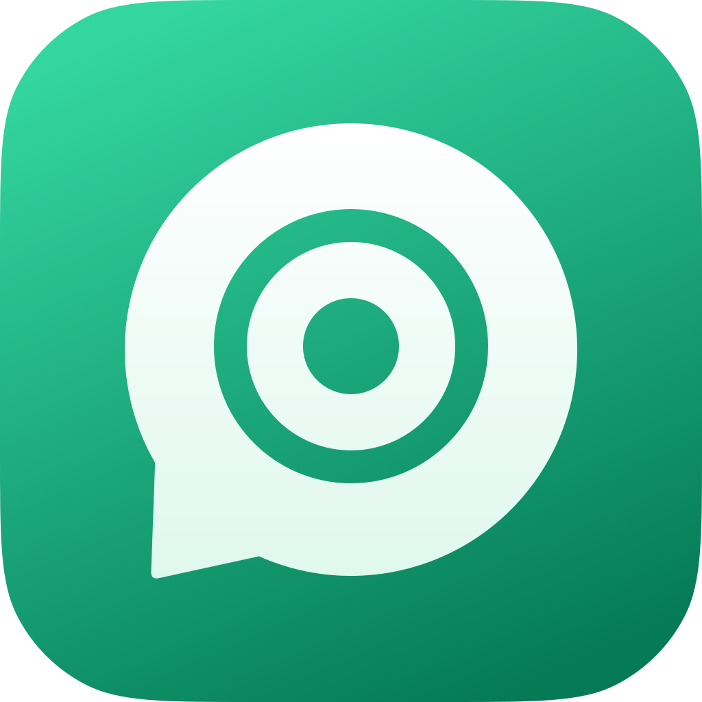
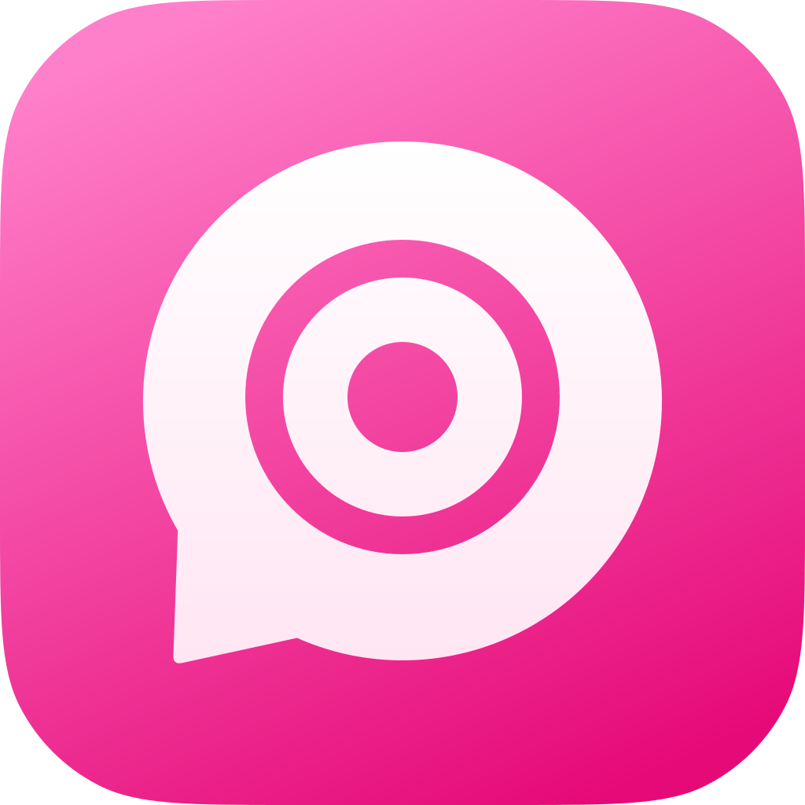

# IssueBot-Logo

Das Zeichen ist eine fette Sprechblase, aus der das „Issue offen“-Symbol (Ring mit Punkt) ausgeschnitten ist.
Es ist die Schwester des [Diddy-Logos](https://github.com/Lndr2501/diddy/tree/main/branding): gleiche Kachel,
gleiche Verläufe, gleicher Blasenschwanz, nur ein anderes Motiv und als Standard Grün statt Pink.

<p>
  
  
  
</p>

## Dateien

Farbtöne: `green` (Standard), `pink` (passt zu Diddy), `black`.

| Datei | Zweck |
|---|---|
| `logo/issuebot-<farbe>-rounded.svg` | Abgerundete Kachel. Für Web, README, GitHub. |
| `logo/issuebot-<farbe>-square.svg` | Volle Fläche ohne Rundung. Für Avatare, die selbst maskieren (Matrix, Element). |
| `logo/issuebot-mark.svg` | Nur das Zeichen, einfarbig (`currentColor`). |
| `../issuebot/assets/avatar.png` | Avatar des Bots (512 px, grün, volle Fläche). Der Bot setzt ihn beim Start selbst. |

## Neu erzeugen

```
pip install cairosvg   # oder rsvg-convert (librsvg)
python3 branding/build.py
```

Form und Farben stehen oben in `build.py`. Die SVG-Dateien nie von Hand ändern, sie werden überschrieben.

Daneben entstehen 1024-px-PNGs in `logo/png/` (nicht im Repo).

## Wo das Logo eingebaut ist

- **README**: Kopfbild.
- **Matrix-Avatar**: `issuebot/assets/avatar.png`. Der Bot lädt ihn beim Start hoch und setzt ihn als Profilbild,
  aber nur, wenn sich die Datei geändert hat. In Diddy und Element erscheint er automatisch.
- **Diddy-Profil**: Banner und Akzentfarbe der Bot-Karte nutzen das Logo-Grün (`PROFILE` in `issuebot/bot.py`).
- **Docker-Image**: Das Bild liegt im Python-Paket und ist damit im Image.
